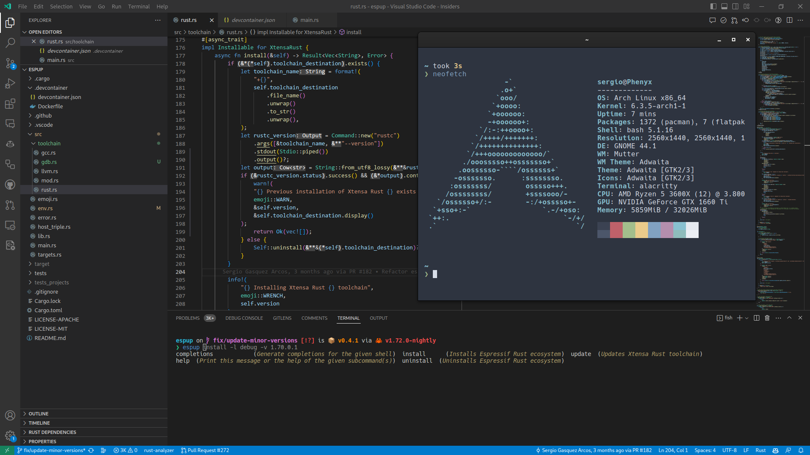
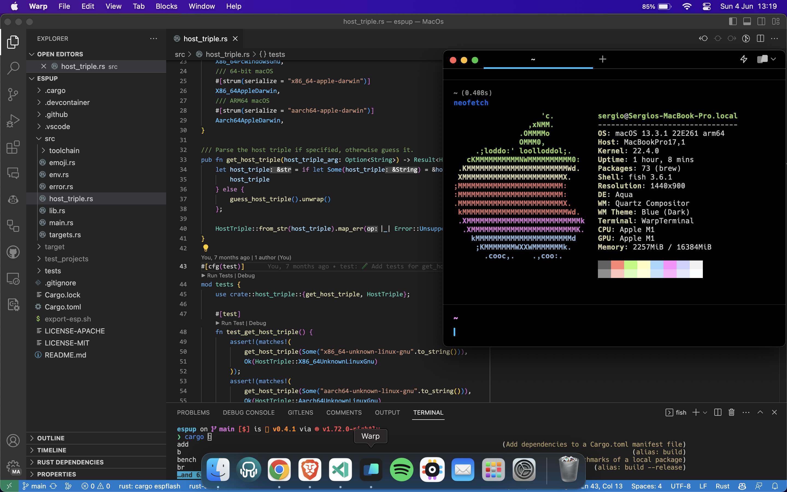
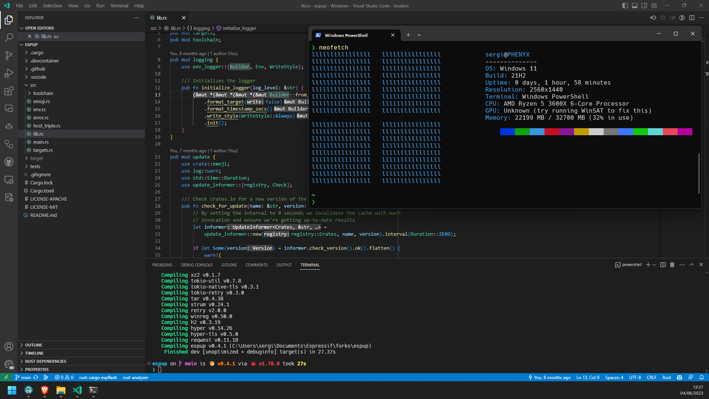

# Dotfiles
Cozy repository where I store my dotfiles:
- [Linux (Arch Linux)](linux)
- [macOS](mac-os)
- [Windows](windows)
- [Pi coding agent](common/pi)
- [Media server](mediaserver)

Linux and Windows are installed in a dual boot environment, see [Installation Guide](InstallationGuide.md) for instructions.

## [Linux (Arch Linux)](linux)



## [macOS](mac-os)



## [Windows](windows)



## Linux and macOS setup

After the platform setup steps in the [Linux](linux#setup-dotfiles) or
[macOS](mac-os#setup-dotfiles) README, run these commands in Bash from the
repository root:

1. Install the extra crates, preserving any arguments on each line:
   ```bash
   cd "$HOME/.dotfiles"
   while IFS= read -r line; do
       read -r -a crate_args <<< "$line"
       cargo install "${crate_args[@]}"
   done < common/rust/crates
   ```
2. Install the Espressif Rust toolchains and generate the export file used by
   Fish:
   ```bash
   espup install
   ```
3. Install [Pi](https://pi.dev/docs/latest/quickstart#install):
   ```bash
   npm install -g --ignore-scripts @earendil-works/pi-coding-agent
   ```
4. Regenerate the Fish completions:
   ```bash
   espup completions fish > common/shell/espup.fish
   espflash completions fish > common/shell/espflash.fish
   ```
   `cargo-espflash` completions must still be added to Fish's `cargo`
   completions manually; avoid appending them more than once.
5. Check that all managed links are correct:
   ```bash
   dot -v check
   ```

### herdr

[`common/herdr/config.toml`](common/herdr/config.toml) is managed at
`~/.config/herdr/config.toml` and makes the herdr TUI send agent finished and
needs-attention notifications through Ghostty for background workspaces. Apply
edits to a running server with `herdr server reload-config`.

The Herdr app's [`settings.json`](common/herdr-app/settings.json) and
`keys.json` ([macOS](mac-os/herdr-app/keys.json),
[Linux](linux/herdr-app/keys.json)) are managed in `~/.config/herdr-app`.
`keys.json` replaces Herdr's default keys, so each platform file holds all of
them. Like Zed's project and Git panels, `Cmd+Shift+E` / `Cmd+Shift+G`
(`Ctrl+Shift+E` / `Ctrl+Shift+G` on Linux, where split down moves to
`Ctrl+Shift+D`) toggle the Files and Changes panels through the `zed-tabs` mod.
Terminals use Ghostty's font, Alt+Backspace (`Ctrl+Backspace` on Linux) deletes
a word as in Ghostty, and `Cmd+K` clears the screen on macOS.
The app applies edits at once and writes setting changes made in the app, such
as zoom, through the links.

The [`my-main`](common/herdr-app/layouts/my-main.json) layout and its
[mods](common/herdr-app/mods) are linked too. They are clones of Herdr's shipped
mods, so they don't get Herdr's updates to the originals:

- `zed-tabs`: the tab bar, plus the `files` and `changes` key commands.
- `zed-files`: the Files panel with Zed's VSCode Dark Modern syntax colors,
  rendered Markdown (with a Source switch) and image previews.
- `split-changes`: the Changes panel with side-by-side diffs that fit the panel;
  drag the divider to resize the sides, double-click it to reset. A diff with
  only additions or only removals shows one column.

Herdr doesn't notice edits made through the linked mod folders; switch to
another layout and back (`Cmd+Shift+L`, `Ctrl+Shift+L` on Linux) to reload
them. Herdr only loads icons and images from inside `~/.config/herdr-app`, so
the linked mods use the shipped mods' icons, and `zed-files` previews an image
from a copy in Herdr's `data/` folder. Herdr writes `gpui-kit.d.ts` and
`jsconfig.json` into each mod folder; they are ignored. Herdr keeps runtime
state, such as panel width and which panel is open, in `layouts/.state`, which
is not managed. It notifies by default: it plays a sound and posts a
notification when an agent finishes or needs attention while its terminal is
not in view.

### Private hosts

`common/ssh/config` holds only generic SSH settings and includes
`~/.dotfiles-private/ssh/*`. Host names, users, IPs, and jump hosts live in the
private `dotfiles-private` repository; SSH ignores the include when that clone is
missing:

```bash
gh repo clone SergioGasquez/dotfiles-private "$HOME/.dotfiles-private"
```

### Remote probe-rs

`$HOME/.probe-rs.toml` defines `<chip>-hil` presets that connect to
`ssh://hil-<chip>:3000`. Keep the private details out of this repository:

- Each `hil-<chip>` host alias, with its user and jump host, is defined in
  `dotfiles-private` (see [Private hosts](#private-hosts)).
- If the runners require a token, set `PROBE_RS_REMOTE_TOKEN` in a local file
  under `~/.config/fish/conf.d/` that is not tracked by this repository.

Then run `probe-rs <command> --preset esp32c6-hil`, or set
`PROBE_RS_CONFIG_PRESET` for tools such as `esp-devtool`.
